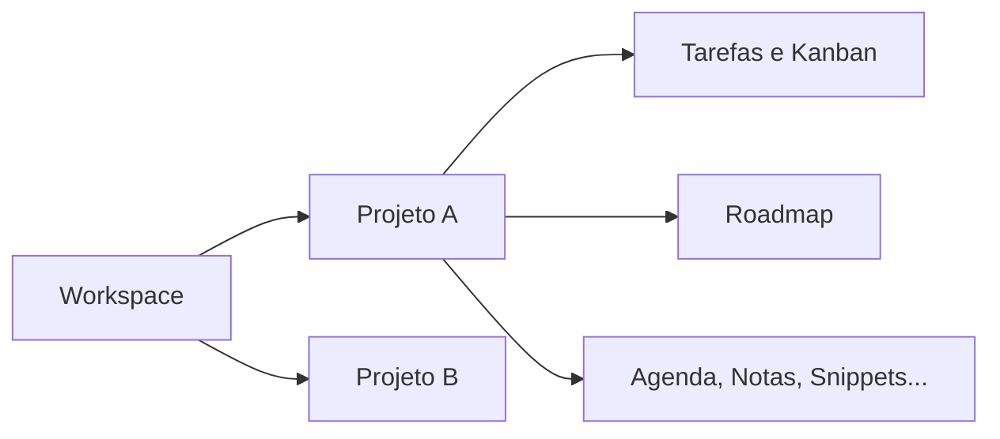

<h1 align="center">Fluxo</h1>

<p align="center">
  Plataforma web que reúne tarefas, agenda, documentação e ferramentas de foco de uma equipe de desenvolvimento em um só lugar.
</p>

<p align="center">
  
  
  
  
  
  
</p>

<p align="center">
  <a href="#sobre">Sobre</a> ·
  <a href="#funcionalidades">Funcionalidades</a> ·
  <a href="#perfis-e-permissões">Perfis e permissões</a> ·
  <a href="#tecnologias">Tecnologias</a> ·
  <a href="#como-executar">Como executar</a> ·
  <a href="#testes">Testes</a> ·
  <a href="#equipe">Equipe</a>
</p>

---

## Sobre

O Fluxo é o Trabalho de Conclusão de Curso do curso de **Análise e Desenvolvimento de Sistemas** da **Fatec Baixada Santista Rubens Lara** (Centro Paula Souza), desenvolvido em 2026.

Uma equipe de software costuma trabalhar com uma ferramenta para tarefas, outra para documentação, outra para agenda e mais alguns aplicativos soltos para anotações e controle de tempo. Cada troca de ferramenta é uma troca de contexto, e isso pesa na concentração de quem está programando. A proposta do Fluxo é juntar essas partes em um único ambiente, organizado por **workspaces** (a empresa ou equipe) e **projetos**, cada um com seus próprios módulos.



## Funcionalidades

| Módulo | O que faz |
| --- | --- |
| **Autenticação** | Cadastro, login, recuperação de senha por e-mail e encerramento de sessão. |
| **Workspaces e membros** | Criação de workspaces, convites, papéis e desativação de membros. |
| **Projetos** | Criação e edição de projetos, membros por projeto e ativação dos módulos de cada um. |
| **Tarefas e Kanban** | Tarefas com prioridade, tipo, responsável, prazo e recorrência; quadro com colunas reordenáveis. |
| **Dashboard** | Tarefas do dia, próximos eventos, hábitos pendentes e números de produtividade. |
| **Agenda** | Eventos com participantes, descrição e visibilidade privada ou para o projeto. |
| **Hábitos** | Hábitos diários ou semanais, com marcação e histórico. |
| **Pomodoro** | Temporizador de foco com ciclos configuráveis e registro das sessões. |
| **Notas** | Editor de texto com blocos, busca e exportação em PDF, DOCX e Markdown. |
| **Base de conhecimento** | Snippets de código, bookmarks e documentos (Vault) com upload de arquivos. |
| **Roadmap** | Etapas do projeto com meta, pontos, prazo e status. |
| **Nami** | Chat com Gemini, chave individual protegida e histórico privado de conversas. |
| **Notificações** | Aviso de tarefas com prazo próximo. |

## Perfis e permissões

O controle de acesso segue o modelo RBAC com quatro papéis por workspace:

| Papel | Pode |
| --- | --- |
| **Owner** | Tudo, inclusive excluir o workspace. |
| **Superadmin** | Gerenciar o workspace, os membros e todos os projetos. |
| **Admin** | Gerenciar os projetos em que participa e seus membros. |
| **Membro** | Usar os módulos conforme a regra definida no projeto. |

Cada módulo de um projeto pode seguir uma de duas regras:

- **Microgerenciamento**: qualquer membro cria, edita e exclui itens. Pensado para equipes que se organizam sozinhas.
- **Hierárquico**: membros só leem e atualizam; criar e excluir fica com Admin ou acima.

## Tecnologias

**Backend** (`apps/backend`)

- [NestJS](https://nestjs.com/) com TypeScript
- [Prisma](https://www.prisma.io/) como ORM e [PostgreSQL](https://www.postgresql.org/) como banco
- [Better Auth](https://www.better-auth.com/) para autenticação
- Nodemailer para envio de e-mails, Helmet e rate limit para segurança
- Jest e Supertest para testes

**Frontend** (`apps/frontend`)

- HTML, CSS e JavaScript sem framework
- [Vite](https://vitejs.dev/) como servidor de desenvolvimento e build
- Lucide (ícones), jsPDF e docx (exportação de notas)
- Playwright para testes de ponta a ponta

**Infraestrutura**

- Monorepo com pnpm workspaces
- PostgreSQL em container Docker
- Husky e lint-staged: lint e checagem de tipos antes de cada commit, suíte completa antes de cada push

## Estrutura do repositório

```txt
fluxo/
├── apps/
│   ├── backend/
│   │   ├── prisma/          schema dividido por domínio e migrações
│   │   ├── src/
│   │   │   ├── common/      autorização, config, banco, e-mail, storage
│   │   │   └── modules/     um módulo NestJS por funcionalidade
│   │   └── test/            testes e2e da API
│   └── frontend/
│       ├── src/
│       │   ├── api/         chamadas à API por recurso
│       │   ├── components/  componentes reutilizáveis
│       │   ├── pages/       telas do sistema
│       │   └── shell/       navegação, menu e painel de configurações
│       └── e2e/             testes Playwright
├── docker-compose.yml
└── package.json
```

## Como executar

### Pré-requisitos

- Node.js 22 (ou 20.11.1+)
- pnpm 9 ou superior
- Docker com Docker Compose

### Passo a passo

**1. Instale as dependências**

```bash
pnpm install
```

**2. Crie os arquivos de ambiente**

```bash
cp .env.example .env
cp apps/backend/.env.example apps/backend/.env
```

O `.env` da raiz configura o container do PostgreSQL. O de `apps/backend` configura a API. Nele, troque pelo menos:

- `BETTER_AUTH_SECRET`: qualquer texto com 32 caracteres ou mais.
- `SMTP_*`: credenciais de um servidor SMTP. Para desenvolvimento, uma caixa de testes do [Mailtrap](https://mailtrap.io/) funciona.
- `VAULT_STORAGE_DIR`: pasta onde os arquivos enviados ao Vault serão gravados.

**3. Suba o banco**

```bash
docker compose up -d
```

O PostgreSQL fica disponível em `localhost:5433`.

**4. Prepare o Prisma**

```bash
pnpm --filter backend prisma:generate
pnpm --filter backend prisma:migrate
```

**5. Inicie a aplicação**

```bash
pnpm dev
```

Esse comando sobe a API e o frontend juntos:

- Frontend: http://localhost:5173
- API: http://localhost:3000/api

O frontend repassa as chamadas de `/api` para o backend, então basta abrir o endereço do frontend e criar uma conta.

> A porta 5173 é fixa. Se ela estiver ocupada, o Vite não sobe em outra porta, porque a origem precisa bater com `FRONTEND_URL` para o login funcionar.

## Testes

```bash
pnpm test                                  # testes unitários e e2e da API
pnpm --filter frontend test:e2e            # testes Playwright da interface
pnpm quality                               # lint + tipos + testes
```

Os testes e2e da API e os do Playwright usam o banco configurado em `apps/backend/.env`, então o container precisa estar rodando. O Playwright usa o Google Chrome instalado na máquina.

## Scripts

| Comando | Descrição |
| --- | --- |
| `pnpm dev` | Sobe backend e frontend em modo de desenvolvimento |
| `pnpm dev:backend` | Sobe só a API |
| `pnpm dev:frontend` | Sobe só o frontend |
| `pnpm build` | Gera o build dos dois apps |
| `pnpm lint` | Roda o ESLint no backend |
| `pnpm typecheck` | Verifica os tipos do backend |
| `pnpm test` | Roda os testes do backend |
| `pnpm quality` | Lint, tipos e testes em sequência |
| `pnpm --filter backend prisma:migrate` | Aplica as migrações em desenvolvimento |
| `pnpm --filter backend prisma:generate` | Gera o Prisma Client |

## Equipe

| Integrante |
| --- |
| Lucas de Melo Paulino |
| Pedro Henrique Silva Quixabeira |
| Rhuan Manoel Mulero dos Santos |
| Thiago Almeida dos Santos Silva |

---

<p align="center">
  Fatec Baixada Santista Rubens Lara · Santos, SP · 2026
</p>

## Assistente Nami (Gemini)

A Nami atende aos requisitos RF47–RF50 e UC09: chat integrado, configuração individual da API, respostas no Fluxo e histórico persistente privado.

1. Aplique as migrações e gere o cliente Prisma após atualizar o projeto.
2. Configure `NAMI_ENCRYPTION_KEY` em `apps/backend/.env` com 64 caracteres hexadecimais. Para gerar: `node -e "console.log(require('node:crypto').randomBytes(32).toString('hex'))"`.
3. Reinicie o backend. Abra **Configurações → Nami**.
4. Configure sua chave do [Google AI Studio](https://aistudio.google.com/apikey) e um modelo disponível na sua conta. O padrão é `gemini-3.5-flash-lite`, ajustável nas preferências.
5. Abra o chat pelo gatinho no canto inferior direito do Playground e envie uma mensagem. Se ainda não houver chave, o chat exibe um aviso. Em **Histórico**, abra uma conversa anterior para continuar; **Nova conversa** inicia outro contexto. É possível excluir a conversa ou remover a chave sem apagar o histórico.

A chave é cifrada com AES-256-GCM antes de ser salva e nunca é devolvida pela API. Preserve a chave de criptografia do servidor: trocá-la exige que os usuários cadastrem novamente suas chaves do Gemini. Não a publique no Git.

As mensagens são enviadas ao Google Gemini. Para incluir dados do projeto ativo, ative **Enviar contexto do projeto ao Gemini** em **Configurações → Nami**. A preferência é salva por conta e projeto neste navegador. A Nami consulta demandas, Kanban, metas, etapas, anotações, agenda e seus hábitos vinculados ao projeto, respeitando o acesso do usuário. Ela também vê nomes e categorias de documentos, links e snippets; não lê arquivos automaticamente. A consulta inclui até 30 itens por categoria e trechos de até 500 caracteres. São enviadas as últimas 40 mensagens como contexto; cada conversa permite até 100 interações. A lista exibe as 100 conversas mais recentes. As respostas são exibidas como texto, preservando código e quebras de linha, sem executar HTML. Cotas, custos e disponibilidade dependem da conta do Gemini.

Testes específicos: `pnpm --filter backend test --runInBand --testPathPatterns=nami` e `pnpm --filter frontend test:e2e nami-chat.spec.js`. Os testes simulam o Gemini, sem consumir créditos ou exigir uma chave real.

Referências: [API Gemini](https://ai.google.dev/api), [modelos](https://ai.google.dev/gemini-api/docs/models).

Pelo chat, a Nami também pode propor a criação de workspaces, projetos, demandas, colunas do Kanban, roadmaps, etapas, anotações, eventos, hábitos, links, snippets, documentos e registros de Pomodoro. Se faltarem dados obrigatórios, ela pede as informações antes de preparar a proposta. Revise o destino e os campos e clique em **Confirmar criação**; o Fluxo aplica as mesmas permissões e validações dos formulários. Para documentos, anexe o arquivo na confirmação.

A Nami também pode buscar itens diretamente nas listas autorizadas do Fluxo e preparar edições. Selecione o resultado para revisar os valores anteriores e propostos; confirme para salvar. As buscas locais não enviam os resultados ao Gemini. O chat não altera acessos, papéis, credenciais nem exclui registros dos módulos.
